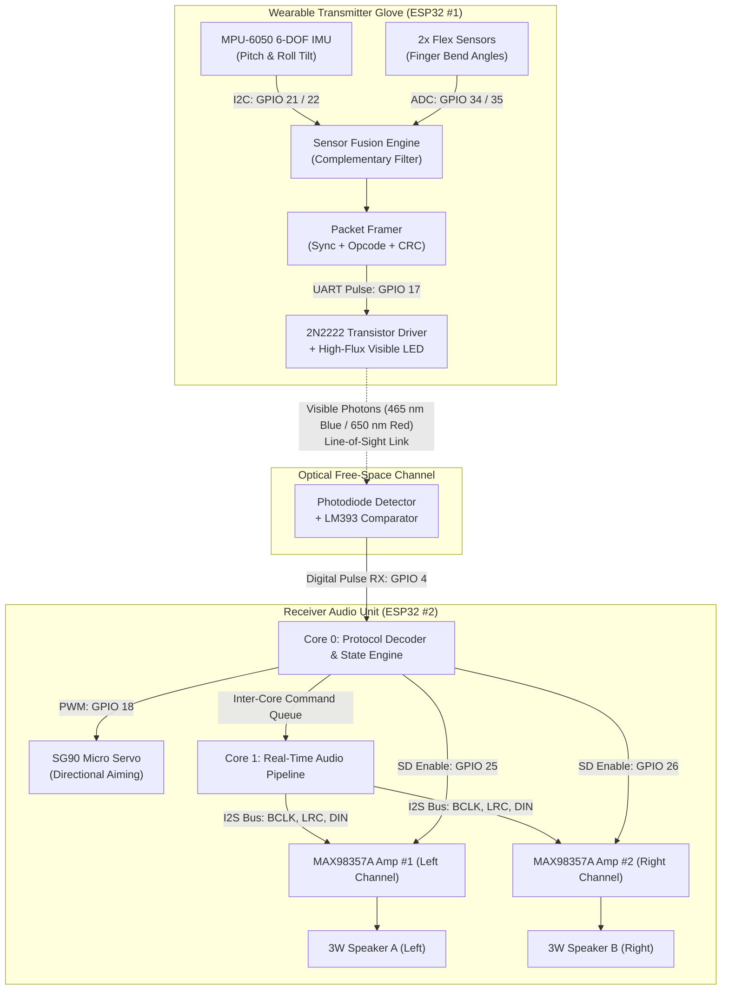

# Gesture-Controlled Music Player using Visible Light Communication (VLC)

An embedded systems hardware project developed for the **Electronics Workshop (EW)** curriculum. The system implements a contactless human-computer interface (HCI) that captures hand kinematics via a smart sensor glove and transmits control commands and audio streams over a free-space **Visible Light Communication (VLC)** optical link to a dual-speaker audio base station.

---

## 🌟 System Overview

Traditional wireless audio controllers rely on Radio Frequency (RF) protocols such as Bluetooth or Wi-Fi, which are susceptible to RF congestion, electromagnetic interference (EMI), and eavesdropping through walls. 

This project explores **Optical Wireless Communication (OWC)** in the visible electromagnetic spectrum ($\lambda = 400\text{ nm} - 700\text{ nm}$):
1. **Wearable Gesture Glove (Transmitter)**: Combines an MPU-6050 6-DOF Inertial Measurement Unit (IMU) and analog flex sensors on an ESP32 microcontroller to classify hand tilts, finger curls, and sweeps.
2. **Optical Wireless Channel (VLC)**: Encodes control frames and analog/digital audio signals into high-frequency optical pulses emitted by a wrist-mounted visible spectrum LED.
3. **Audio Base Station (Receiver)**: Detects optical signals using a photodiode detector, validates frame integrity, actuates an SG90 servo motor for spatial alignment, and drives dual MAX98357A Class-D digital amplifiers over a hardware I²S bus to power stereo speakers.
4. **Dual Operational Modes**:
   * **VLC Optical Link Mode**: Direct line-of-sight optical transmission to base station speakers.
   * **Bluetooth HID Media/Presentation Mode**: Direct wireless pairing with laptops or mobile devices for music playback or presentation slide navigation.

---

## 🏗️ System Architecture



---

## ✋ Kinematic Gesture Commands

| Gesture | Sensor Trigger Conditions | VLC Command / Action | Function |
|---|---|:---:|---|
| **Fist Clench** | Both index & middle fingers bent | `0x10` | **Play / Pause Toggle** |
| **Tilt Forward** | Hand pitched downward ($\theta < -28^\circ$) | `0x21` | **Volume Down (-5%)** |
| **Tilt Backward** | Hand pitched upward ($\theta > +28^\circ$) | `0x20` | **Volume Up (+5%)** |
| **Tilt Left** | Hand rolled counter-clockwise ($\phi < -32^\circ$) | `0x31` | **Previous Track** (or Previous Slide) |
| **Tilt Right** | Hand rolled clockwise ($\phi > +32^\circ$) | `0x30` | **Next Track** (or Next Slide) |
| **Point Index** | Index finger straight, middle finger bent | `0x40` | **Route Audio to Speaker A** |
| **Peace Sign (V)** | Both index & middle fingers straight | `0x41` | **Route Audio to Speaker B** |
| **Hand Sweep** | Flat hand sweeping ($\vert\theta\vert < 15^\circ$, $\phi \in [0^\circ, 180^\circ]$) | `0x50` | **Aim Servo to Hand Angle** |

---

## 📁 Repository Structure

```
EW-project/
├── .gitignore                                 # Git ignore rules for embedded and Python tools
├── LICENSE                                    # MIT License
├── README.md                                  # Master project documentation
├── docs/                                      # Detailed technical specifications
│   ├── ARCHITECTURE.md                        # System architecture & FreeRTOS task models
│   ├── GESTURE_MAPPINGS.md                    # Gesture kinematic matrix & equations
│   ├── HARDWARE_BOM.md                        # Bill of Materials, component specs & pricing
│   ├── VLC_PROTOCOL.md                        # Optical PHY and data-link specifications
│   └── WIRING_GUIDE.md                        # Schematics, resistor calculations & pinouts
├── presentation/                              # Academic project presentation
│   └── Gesture_Controlled_Music_Player_VLC.pptx # 8-slide presentation deck (16:9 Widescreen)
├── firmware/                                  # Complete microcontroller firmware suite
│   ├── platformio.ini                         # PlatformIO multi-environment configuration
│   ├── transmitter_glove/                     # Primary Gesture Glove Controller
│   │   ├── config.h                           # Pinouts, thresholds, and opcodes
│   │   └── transmitter_glove.ino              # Sensor fusion & optical packet transmitter
│   ├── receiver_player/                       # Dual MAX98357A I2S Audio Base Station
│   │   ├── config.h                           # Pinouts, I2S clocks, and servo settings
│   │   └── receiver_player.ino                # Dual-core FreeRTOS I2S audio engine
│   ├── gesture_ble_presentation/              # Bluetooth HID Media & Slide Presentation Controller
│   │   └── gesture_ble_presentation.ino       # MPU-6050 + BleKeyboard with slide navigation
│   ├── vlc_audio_transmitter/                 # Direct Analog Audio-to-LED Optical Transmitter
│   │   └── vlc_audio_transmitter.ino          # DSP filtering, soft-clipping & high-speed PWM
│   ├── vlc_photodiode_receiver/               # Direct Photodiode Optical Audio Receiver
│   │   └── vlc_photodiode_receiver.ino        # ADC envelope detector & DAC audio output
│   └── tests/                                 # Hardware Bench Test Sketches
│       ├── lm386_dac_volume_test.ino          # DAC volume sweep for LM386 amp testing
│       └── photodiode_adc_test.ino            # Photodiode ADC threshold diagnostic
└── scripts/
    └── vlc_test_transmitter.py                # Python serial diagnostic utility
```

---

## 🚀 Quick Start & Flashing Guide

### Method A: Arduino IDE
1. Install the **ESP32 Board Support Package** via Arduino Boards Manager (`https://raw.githubusercontent.com/espressif/arduino-esp32/gh-pages/package_esp32_index.json`).
2. Install required libraries via Library Manager:
   * `Wire` (Built-in)
   * `Adafruit MPU6050` & `Adafruit Unified Sensor` (by Adafruit)
   * `ESP32-BLE-Keyboard` (by T-vK, for BLE presentation mode)
3. **Flashing Options**:
   * For **VLC Glove + I2S Base Station**:
     * Flash `firmware/transmitter_glove/transmitter_glove.ino` to Glove ESP32.
     * Flash `firmware/receiver_player/receiver_player.ino` to Base Station ESP32.
   * For **Direct Audio-over-Light VLC Link**:
     * Flash `firmware/vlc_audio_transmitter/vlc_audio_transmitter.ino` to transmitter ESP32.
     * Flash `firmware/vlc_photodiode_receiver/vlc_photodiode_receiver.ino` to receiver ESP32.
   * For **Bluetooth Media / Slide Controller**:
     * Flash `firmware/gesture_ble_presentation/gesture_ble_presentation.ino`.
4. Open Serial Monitor at **115200 baud** for live telemetry and debugging.

### Method B: PlatformIO
```bash
cd firmware

# Flash the Transmitter Glove
pio run -e transmitter_glove -t upload

# Flash the Receiver Base Station
pio run -e receiver_player -t upload
```

### Optical Bench Testing
To verify the base station without the glove, use the test script:
```bash
python3 scripts/vlc_test_transmitter.py --port /dev/ttyUSB0 --interactive
```

---

## 👥 Project Team: Chammaks
* **Shreyaas Sarkar**: Sensor glove fabrication, kinematics calibration, wearable assembly
* **Jonathan Robin**: VLC optical transmitter driver, photodiode amplifier, audio DSP
* **Aditya Gokhale**: FreeRTOS firmware, I²S bus integration, hardware testing & presentation deck

---

## 📽️ Project Presentation
The complete 8-slide PowerPoint presentation is available at [presentation/Gesture_Controlled_Music_Player_VLC.pptx](file:///home/shreyaas/Desktop/EW-project/presentation/Gesture_Controlled_Music_Player_VLC.pptx) (16:9 Widescreen format, themed dark modern slide deck).

---

## 📄 License
This project is licensed under the [MIT License](file:///home/shreyaas/Desktop/EW-project/LICENSE).
