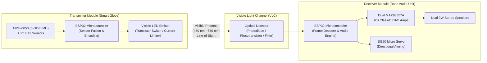

# System Architecture & Technical Specification

The **Gesture-Controlled Music Player using Visible Light Communication (VLC)** is an embedded hardware system developed for the Electronics Workshop (EW) curriculum. It provides contactless, optical wireless human-computer interaction for digital audio playback.

---

## 1. High-Level Architecture

The system is decomposed into two distinct hardware modules interconnected via a free-space Optical Wireless Communication (OWC) link in the visible spectrum:



---

## 2. Subsystem Breakdown

### 2.1. Module 1: Wearable Gesture Transmitter (Glove Unit)
* **Microcontroller**: ESP32-WROOM-32D (Tensilica Xtensa dual-core @ 240 MHz).
* **Kinematic Sensing**:
  * **MPU-6050**: 3-axis accelerometer and 3-axis gyroscope interfaced over I²C (`SDA` = GPIO 21, `SCL` = GPIO 22). Measures hand tilt (Pitch: ±90°, Roll: ±180°).
  * **Analog Flex Sensors**: 2.2-inch resistive sensors mounted on index and middle fingers. Arranged in a voltage divider network with 22 kΩ precision pull-down resistors into ESP32 ADC channels (`GPIO 34`, `GPIO 35`).
* **Optical Emitter**:
  * High-flux visible LED (focused 5mm or 1W star LED with 2N2222 / 2N7000 MOSFET driver).
  * Mounted on the dorsal surface of the wrist aiming along the longitudinal axis of the hand.
* **Power Supply**:
  * 3.7V 1000 mAh Single-cell Lithium-Polymer (LiPo) battery.
  * TP4056 charge management module with over-discharge / short-circuit protection (DW01A + FS8205A).
  * Ultra-low-dropout regulator (e.g. ME6211 / AMS1117-3.3V) feeding the 3.3V rail.

### 2.2. Module 2: Base Station & Audio Engine (Central Unit)
* **Microcontroller**: Secondary ESP32-WROOM-32D.
* **Optical Receiver Subsystem**:
  * Fast silicon PIN photodiode / phototransistor with optical collimator / daylight blocking filter (tuned for visible wavelengths).
  * High-speed analog comparator circuit (LM393) with adjustable potentiometer threshold for clean digital pulse recovery, or 38 kHz optical envelope demodulator.
* **Audio Digital-to-Analog Subsystem**:
  * Dual **MAX98357A** PCM input Class-D audio amplifiers.
  * Interfaced using ESP32 hardware **I²S peripheral**:
    * Shared Bit Clock (`BCLK` / SCK): `GPIO 22`
    * Shared Word Select (`LRC` / WS): `GPIO 21`
    * Shared Serial Data (`DIN` / SDATA): `GPIO 19`
  * Independent Channel Select:
    * Amp #1 `GAIN_SLOT / SEL` pulled to `GND` (Left Channel playback).
    * Amp #2 `GAIN_SLOT / SEL` pulled to `3.3V` (Right Channel playback).
  * Independent Channel Power Muting:
    * Amp #1 Shutdown (`SD_MODE`): `GPIO 25`
    * Amp #2 Shutdown (`SD_MODE`): `GPIO 26`
* **Mechanical Actuation Subsystem**:
  * SG90 9g micro-servo driven via ESP32 hardware PWM (LEDC peripheral) on `GPIO 18`. Rotates optical collector or speaker redirector through 0° to 180°.
* **Audio Generation & Storage**:
  * SPI MicroSD Card reader module (or ESP32 Flash SPIFFS / LittleFS audio tone synthesizer / Bluetooth A2DP Sink).
  * Dual 3W 4Ω full-range dynamic cone speakers.

---

## 3. Dual-Core Task Allocation (FreeRTOS Architecture)

The ESP32 firmware maximizes throughput and zero-jitter audio playback by segregating workloads across its two hardware processor cores:

```
+-----------------------------------------------------------+
|                      ESP32 DUAL CORE                      |
|                                                           |
|       CORE 0 (Protocol & I/O)      CORE 1 (Application)   |
|   +-----------------------------+ +---------------------+ |
|   |  - Optical Pulse ISR / UART | | - I2S Audio Stream  | |
|   |  - Packet Framing & CRC     | | - Audio Decoding    | |
|   |  - Gesture State Machine    | | - Buffer Management | |
|   |  - PWM Servo Position Task  | | - Volume / Gain     | |
|   +-----------------------------+ +---------------------+ |
|                  ^                           ^            |
|                  |     xQueueSendToBack()    |            |
|                  +---------------------------+            |
|                   Inter-Core Command Queue                |
+-----------------------------------------------------------+
```

1. **Core 0 (Protocol & Real-Time I/O)**:
   * Handles edge interrupts from the optical receiver photodetector.
   * Runs the packet framing state machine, validating preamble, payload, and checksum bytes.
   * Dispatches commands to the inter-core FreeRTOS queue (`cmdQueue`).
   * Manages servo angle sweep via the LEDC hardware timer.

2. **Core 1 (Real-Time Audio Pipeline)**:
   * Dedicates 100% of its cycle budget to feeding the I²S DMA buffers (`i2s_write()`).
   * Prevents audio underrun or pops when complex gestures are decoded.
   * Applies software attenuation (volume levels 0 to 100%).
   * Controls the MAX98357A `SD_MODE` pins to toggle active speakers cleanly.
