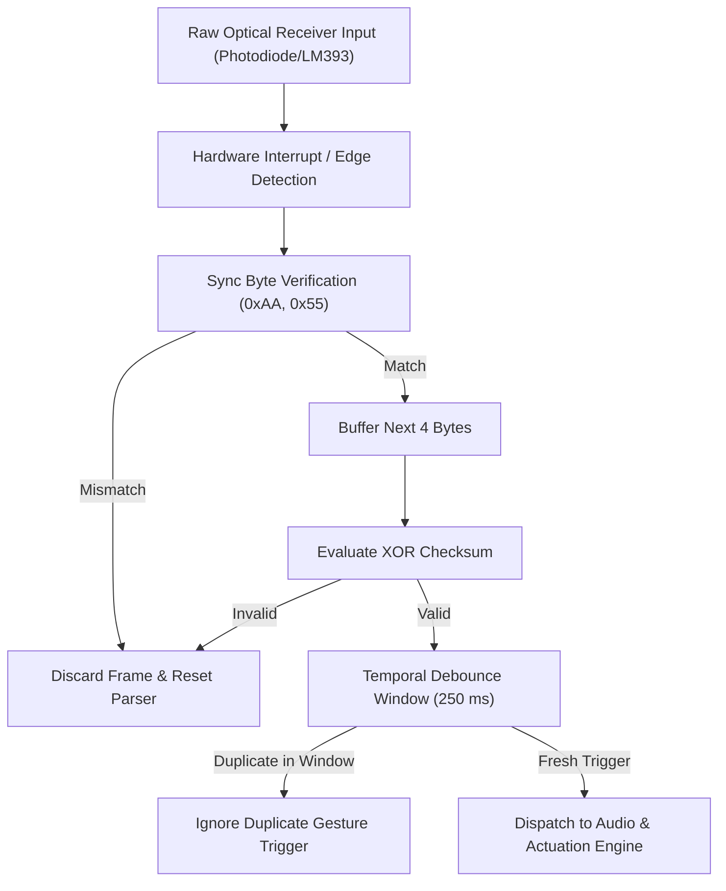

# Visible Light Communication (VLC) Protocol Specification

This document specifies the physical, data link, and application layer protocols governing the optical wireless transmission between the **Transmitter Glove** and the **Receiver Audio Station**.

---

## 1. Physical Layer (PHY)

### 1.1. Optical Spectrum Compliance
* **Operating Wavelength**: Visible electromagnetic spectrum ($\lambda \in [400\text{ nm}, 700\text{ nm}]$).
  * Recommended Primary: **Royal Blue LED ($\lambda_{\text{peak}} \approx 465\text{ nm}$)** or **Deep Red LED ($\lambda_{\text{peak}} \approx 650\text{ nm}$)**.
  * Contrast with Infrared: Strictly non-infrared (avoids 850 nm and 940 nm) to fulfill academic EW workshop and IEEE 802.15.7 VLC standards.
  * White LED consideration: Phosphor persistence (yellow phosphor decay time $\sim 1\text{ }\mu\text{s}$) reduces high-frequency modulation depth; blue and red LEDs provide direct band-to-band recombination with sub-microsecond rise/fall times.

### 1.2. Optical Modulation Scheme
* **Modulation**: **Carrier-Modulated On-Off Keying (OOK)** or **Baseband UART-over-Light**.
  * **Carrier-Modulated OOK (Recommended for High Ambient Light)**:
    * Logical '0': Optical emitter active at 38 kHz square wave (50% duty cycle) for $560\ \mu\text{s}$, followed by $560\ \mu\text{s}$ dark space.
    * Logical '1': 38 kHz optical burst for $560\ \mu\text{s}$, followed by $1690\ \mu\text{s}$ dark space (NEC-style timing).
  * **Direct Baseband UART (Direct Photodiode Mode)**:
    * Standard asynchronous NRZ (Non-Return-to-Zero) UART framing at **2400 bps** or **4800 bps** (8 data bits, no parity, 1 stop bit).
    * Logic HIGH: LED energized (Photon emission).
    * Logic LOW: LED de-energized (Dark state).

---

## 2. Data Link Layer (DLL) & Frame Architecture

Each transmitted control frame consists of a 6-byte structure designed to prevent false triggers from ambient room illumination, sunlight, or shadow flickers:

```
+------------+------------+-----------+--------+--------+----------+
| SYNC_1     | SYNC_2     | DEV_ID    | OPCODE | VALUE  | CHECKSUM |
| (0xAA)     | (0x55)     | (0x01)    | (1 B)  | (1 B)  | (1 B)    |
+------------+------------+-----------+--------+--------+----------+
```

### 2.1. Frame Field Descriptions

| Field | Size (Bytes) | Hex Value | Description |
|---|:---:|:---:|---|
| **SYNC_1** | 1 | `0xAA` | Alternating bit sync preamble (`10101010b`) to calibrate receiver slicing threshold. |
| **SYNC_2** | 1 | `0x55` | Framing delimiter (`01010101b`) confirming valid start of frame. |
| **DEV_ID** | 1 | `0x01` | Node Identifier (Sender: Glove Controller #1). |
| **OPCODE** | 1 | `0x10`–`0x60` | Operational command code (Playback, volume, track, routing). |
| **VALUE** | 1 | `0x00`–`0xFF` | Contextual parameter (e.g., servo angle 0°–180°, volume step, or padding). |
| **CHECKSUM**| 1 | Variable | 8-bit XOR checksum over `DEV_ID`, `OPCODE`, and `VALUE`. |

### 2.2. Checksum Calculation Formula
$$\text{CHECKSUM} = \text{DEV\_ID} \oplus \text{OPCODE} \oplus \text{VALUE}$$

If the receiver computes a checksum mismatch upon receiving 6 bytes, the frame is silently dropped and an error counter is incremented.

---

## 3. Application Layer Command Set (Opcodes)

| Opcode Name | Hex Code | Payload Value | Description & Receiver Action |
|---|:---:|:---:|---|
| `CMD_PLAY_PAUSE` | `0x10` | `0x00` | Toggles audio playback between PLAY and PAUSE states. |
| `CMD_VOL_UP` | `0x20` | Step (`0x01`–`0x05`) | Increments audio output gain by designated step (max 100%). |
| `CMD_VOL_DOWN` | `0x21` | Step (`0x01`–`0x05`) | Decrements audio output gain by designated step (min 0%). |
| `CMD_TRACK_NEXT` | `0x30` | `0x00` | Advances to next audio track in playlist. |
| `CMD_TRACK_PREV` | `0x31` | `0x00` | Skips to previous audio track in playlist. |
| `CMD_SELECT_SPK_A`| `0x40` | `0x00` | Enables Speaker 1 (`GPIO 25` HIGH) and mutes Speaker 2 (`GPIO 26` LOW). |
| `CMD_SELECT_SPK_B`| `0x41` | `0x00` | Enables Speaker 2 (`GPIO 26` HIGH) and mutes Speaker 1 (`GPIO 25` LOW). |
| `CMD_SERVO_AIM` | `0x50` | Angle (`0x00`–`0xB4`) | Sets SG90 micro-servo arm to absolute position (0° to 180°). |
| `CMD_MUTE_ALL` | `0x60` | `0x00` | Hardware shutdown on both MAX98357A amplifiers (`SD` lines LOW). |

---

## 4. Optical Noise Rejection & Fault Tolerance



1. **Ambient Light Mitigation**:
   * An optical filter or black collimating tube (3D printed or heat-shrink shroud) restricts the receiver acceptance angle to $\pm 25^\circ$.
   * Prevents overhead 50 Hz / 100 Hz fluorescent lighting or direct daylight from saturating the photodetector photodiode junction.
2. **Hysteresis & Debouncing**:
   * All recognized gestures enforce a software refractory period of **250 ms** to eliminate duplicate command bursts during natural human hand tremors.
